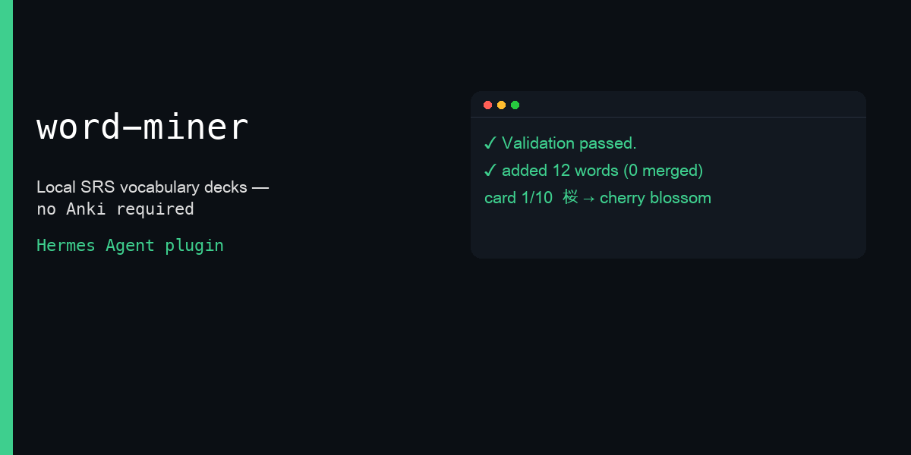
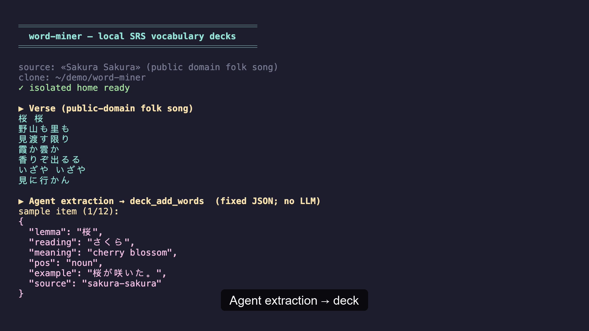

# word-miner

[▶ Demo video (≈40 s)](assets/demo.mp4) — real tool handlers running in an isolated Hermes home.

Turn any text you are consuming — song lyrics, subtitles, an article, a chat — into a personal vocabulary deck and run short daily spaced-repetition sessions **inside Hermes**. Any language pair. Local only: no Anki, no AnkiConnect, nothing to install.

## 30-second quickstart

1. Enable the plugin in an isolated Hermes home (or your profile).
2. Paste a verse / subtitle block and ask the agent to mine words (skill `word-miner:word-miner-extract`).
3. Agent calls `deck_add_words` with structured lemmas.
4. Study: `/deck ja-en` → `/deck reveal` → `/deck grade 3` (or type the answer).
5. Check progress: `/deck stats` or tool `deck_stats`.

## Demo script

See [`docs/DEMO.md`](docs/DEMO.md) for a <90 s shot list. Short version:

1. Paste 4–6 lines of lyrics → agent extracts ~12 lemmas → `deck_add_words` reports added=12.
2. `/deck ja-en` shows card 1/10 with a live timer path via reveal → grade.
3. `/deck stats` shows levels, due today, streak, graduation counts.

## Tools

| Tool | Purpose |
|------|---------|
| `deck_add_words` | Add/merge lemmas into a deck (`deck`, `items[{lemma, reading?, meaning, pos?, example?, source?}]`) → added/merged/skipped |
| `deck_session` | Next ≤10-card session (3+3+3+1 composition, active rotation &lt; 20, nearest-due top-up) |
| `deck_grade` | Grade by typed answer and/or rating 1–4; optional `response_ms` |
| `deck_stats` | Levels, due today, study-day streak, graduation progress |

## Commands

| Command | Purpose |
|---------|---------|
| `/deck <name>` | Start / continue a one-card-at-a-time session |
| `/deck reveal` | Show the answer |
| `/deck grade …` | Typed answer or self-grade 1–4 |
| `/deck next` | Advance after grading |
| `/deck stats [name]` | Stats panel in chat |
| `/deck list` | List decks |

## Skill

`word-miner:word-miner-extract` — how to mine lemmas from lyrics/subtitles well (prefer lemmas, skip names/known words, include readings for CJK, short meanings, ask which deck).

## Data & network disclosure

- **Network:** none. No outbound HTTP, no dictionary APIs, no telemetry.
- **Reads outside plugin data:** none at runtime. Unit tests and validation use only the plugin tree and the isolated `HERMES_HOME`.
- **Shell / background:** none.
- **Stored data:** SQLite database under Hermes `plugin-data/word-miner/data.db` (append-only event log + derived card state). Decks, lemmas, meanings, readings, examples, and review history live there. Configurable `daily_new_cap` (default 20) in plugin settings.

## Limitations

- Linguistics are model-driven (no MeCab/fugashi). Bad extractions lemmas = bad cards.
- Desktop flashcard pane (`desktop/plugin.js`) needs the agent half enabled so `dashboard/plugin_api.py` mounts; treat the pane as best-effort until verified in Desktop.
- Japanese te/ta conjugation helper was not ported; core is language-agnostic.
- Contrast with the catalog `anki` plugin: this one needs no Anki install and no AnkiConnect.

## License

License: TBD by author
